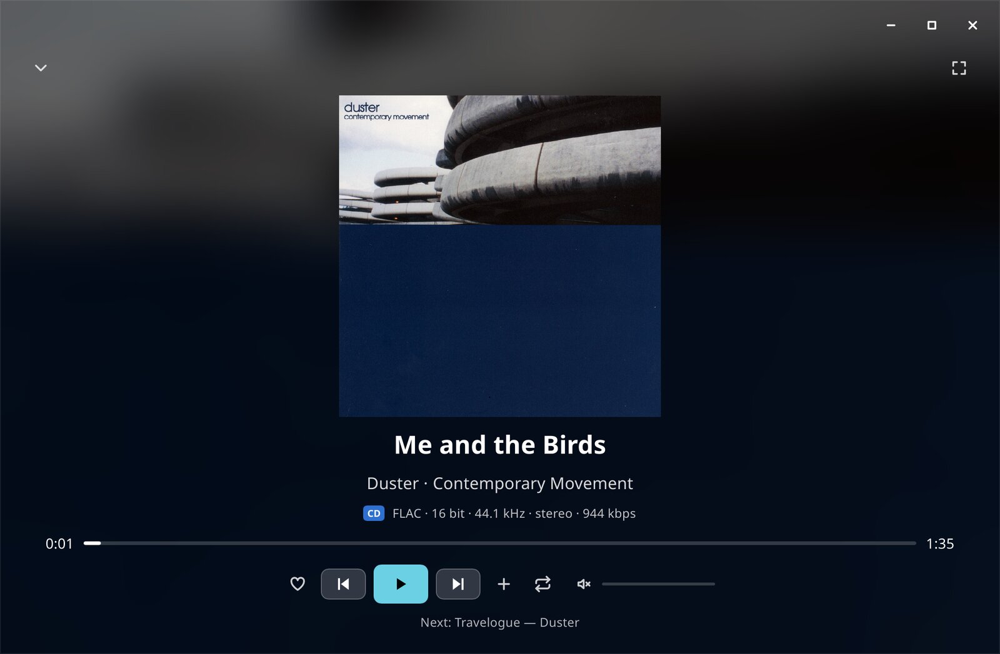
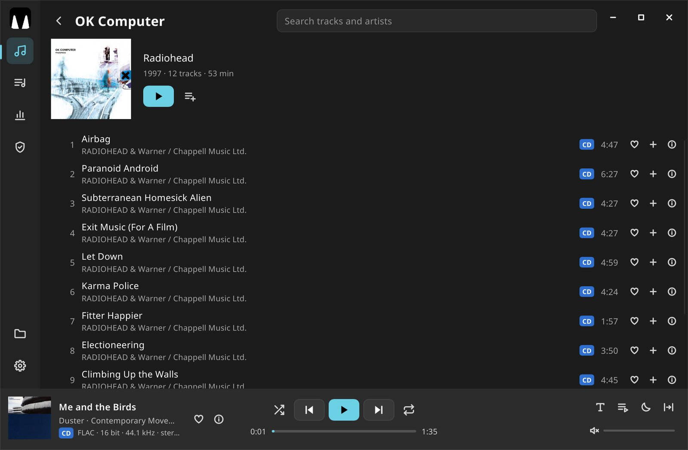
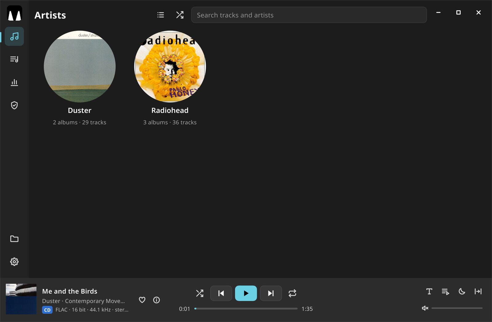
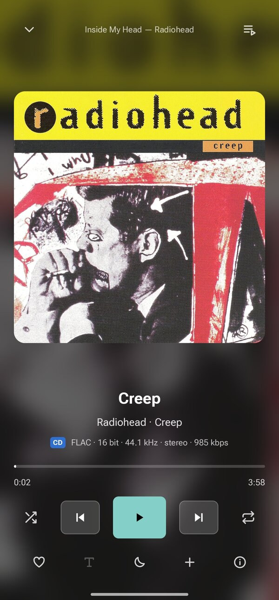
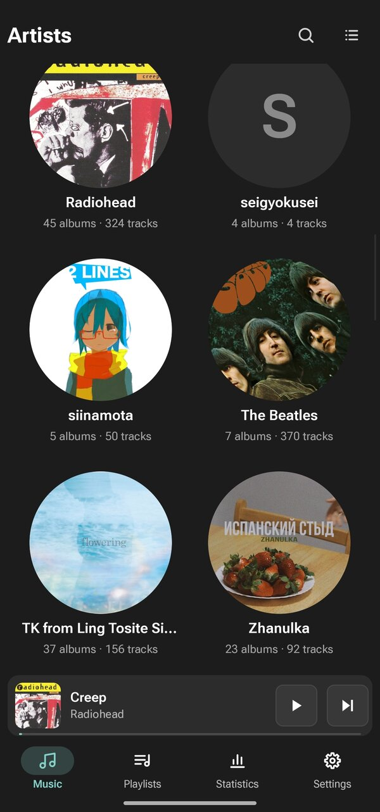
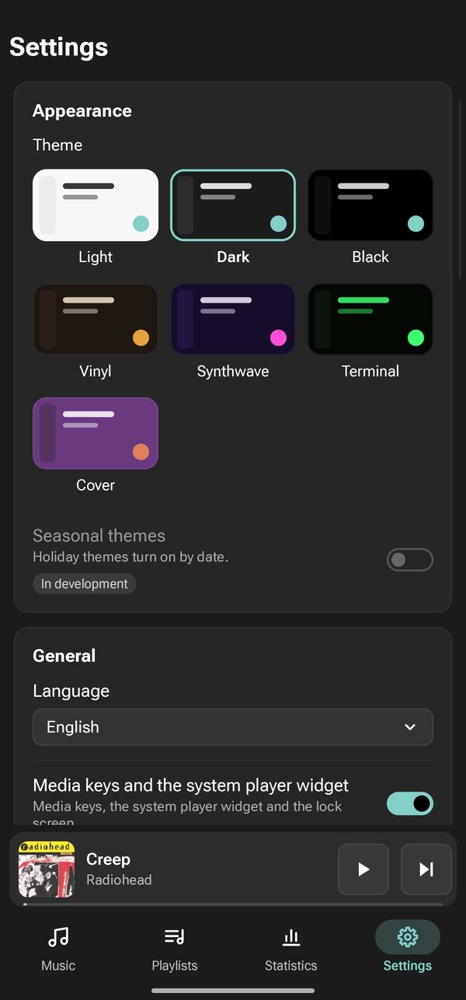

# Nyanoto

Музыкальный плеер для своей коллекции файлов. Linux, Windows и Android.

[English version](README.en.md)

> Статус: **0.1.3-pre-alpha**. Готовых сборок пока нет, плеер собирается из исходников (см. «Сборка»).
> Основная работа идёт на Linux; Windows и Android собираются из того же кода.



## Зачем он

Хотелось плеер, который быстро открывает большую папку с музыкой, играет почти любой формат
и при этом занимает мало памяти. В простое Nyanoto берёт около 55 МБ ОЗУ и 0 % процессора,
во время воспроизведения — около 1 % процессора.

Плеер ничего не грузит из сети и ничего туда не отправляет. Всё, что он знает о музыке,
хранится в одной базе SQLite у вас на диске. Сами файлы он только читает.

Всё дополнительное — модули: они выключены, пока вы сами их не включите в настройках.

## Скриншоты

| Альбом | Исполнители |
|---|---|
|  |  |

| Телефон: полный плеер | Телефон: библиотека | Телефон: настройки |
|---|---|---|
|  |  |  |

## Что умеет

### Библиотека
- Несколько папок с музыкой: диски, флешки, сетевые папки. Отключённый диск не стирает лайки и историю.
- Раскладка для каждой папки своя: по папкам («Исполнитель / Альбом»), по тегам или по композиторам
  (для классики).
- Исполнители и альбомы сеткой или списком, обложки из папки альбома или из тегов.
- Аватар исполнителя: своё фото или картинка из папки исполнителя.
- Поиск, который понимает неправильную раскладку и опечатки: `ghbdtn` найдёт «привет».
- Плейлисты, «Любимые», очередь с историей.
- Сканирование идёт в фоне, интерфейс при этом не подвисает (проверялось на 100 000 файлов).

### Воспроизведение
- Переходы между треками без пауз (gapless).
- Скорость от 0,25× до 3× с сохранением высоты звука.
- Кроссфейд между треками разных альбомов.
- Таймер сна: на время или после текущего трека.
- Повтор отрезка A–B.
- Перемешивание треков или альбомов. Когда альбом доиграл — можно продолжить другим альбомом того же
  исполнителя.
- Пауза, когда отключили наушники.

### Тексты песен
- Синхронные тексты из файла `.lrc` рядом с треком или из тегов.
- Два вида: обычные строки и «сцены» — анимированный текст в стиле колонки Cotodama. Стиль сцены
  подбирается по настроению трека, которое плеер слушает сам.
- Редактор `.lrc` (на компьютере): набрать текст, расставить метки на слух по волне трека, сохранить.

### Статистика и плейлист дня
- Статистика прослушиваний и «карта»: исполнители и альбомы кругами, чем больше слушали — тем крупнее.
- Плейлист дня: каждый день новая подборка из вашей же библиотеки — знакомое плюс немного нового,
  порядок волной по темпу.

### Проверка файлов
- Проверка подлинности качества (бета): ищет «без потерь», сделанные из MP3, и растянутый Hi-Res.
  Это догадка по спектру, а не доказательство.
- «Здоровье» библиотеки: битые файлы, дубликаты, пропуски в альбомах.

### Внешний вид
- Темы: светлая, тёмная, чёрная для OLED, «Винил», «Синтвейв», «Терминал» и «Обложка» (цвета берутся
  из обложки играющего трека).
- Масштаб интерфейса 80–150 %.
- Русский и английский язык.

### Связь с системой
- Linux: медиаклавиши и виджет плеера через MPRIS (GNOME, KDE, `playerctl`).
- Windows: медиаклавиши и панель громкости (SMTC).
- Android: уведомление с кнопками, экран блокировки, кнопки наушников.
- Жесты тачпада и сенсорного экрана: вбок — назад и вперёд, вниз — свернуть плеер.

### На телефоне
Свой интерфейс под палец: вкладки снизу, мини-плеер над ними, полный плеер на весь экран
(свайп вниз — свернуть, вбок — другой трек). Музыка играет в фоне, жест «Назад» на главном экране
уводит плеер в фон, а не закрывает его.

## Форматы

Коротко: играет почти всё, что встречается в музыкальных коллекциях.

| Без потерь | С потерями | Прочее |
|---|---|---|
| FLAC, ALAC, WAV, AIFF, WavPack, Monkey's Audio (APE), TTA, DSD (DSF, DFF), TAK¹, WMA Lossless¹, TrueHD¹ | MP3, AAC, Opus, Vorbis, Musepack, WMA¹, AC3¹, DTS¹ | ATRAC¹, RealAudio¹, речевые кодеки¹ |

¹ через FFmpeg, если он есть (см. ниже). Подробная таблица с тем, чем декодируется каждый формат
и насколько проверен, — в [docs/FORMATS.md](docs/FORMATS.md).

FLAC, WavPack, APE и TTA сверены бит в бит с эталонными декодерами, у Opus точная длина до отсчёта. DSD переводится в PCM
88,2 или 176,4 кГц своим фильтром.

## Быстрый старт

1. Соберите плеер (см. «Сборка») и запустите `nyanoto`.
2. Нажмите «Выбрать папку с музыкой» и укажите папку.
3. Плеер спросит, как раскладывать эту папку: по папкам или по тегам. Если музыка лежит как
   «Исполнитель / Альбом / треки» — выбирайте «по папкам», если всё вперемешку — «по тегам».
4. Дождитесь сканирования (полоска под заголовком) — и всё.

Модули включаются в настройках. Папку можно добавить и из командной строки:
`nyanoto ~/Music`.

На Android при первом запуске плеер попросит «Доступ ко всем файлам»: без него он не увидит
обложки `cover.jpg` и тексты `.lrc` рядом с музыкой. Потом сам предложит добавить папку `Music`.

**Где хранятся данные:** база, настройки и кэш обложек лежат в `~/.local/share/nyanoto` (Linux),
`%APPDATA%\nyanoto` (Windows) или во внутренней папке приложения (Android).

## Горячие клавиши

| Клавиша | Что делает |
|---|---|
| Пробел | пауза / играть |
| ← / → | перемотка на 5 секунд (с Shift — на 30) |
| Ctrl+← / Ctrl+→ | предыдущий / следующий трек |
| ↑ / ↓ | громче / тише |
| M | выключить или вернуть звук |
| L | в «Любимые» или убрать |
| Q | очередь |
| Ctrl+F или / | поиск |
| Esc | назад, закрыть окно, выйти из поля ввода |

Медиаклавиши клавиатуры тоже работают. Буквы срабатывают и в русской раскладке.

## Сборка

Нужен Rust 1.88 или новее (для Android — 1.92). Все звуковые библиотеки (libopus, libwavpack,
Monkey's Audio SDK, libmpcdec, Signalsmith Stretch) лежат в `crates/nyanoto-core/vendor` и собираются
вместе с плеером, отдельно ставить их не нужно.

### Linux

```sh
# Fedora
sudo dnf install gcc-c++ alsa-lib-devel fontconfig-devel
# Debian / Ubuntu
sudo apt install g++ pkg-config libasound2-dev libfontconfig1-dev

cargo build --release -p nyanoto-app
./target/release/nyanoto
```

Ярлык и значки для меню — в `packaging/linux` и `packaging/icons`.

### Windows

```sh
cargo build --release -p nyanoto-app
```

Собирается MSVC или из Linux кросс-компилятором llvm-mingw (цель `x86_64-pc-windows-gnullvm`).
Значок программы — `packaging/windows/nyanoto.ico`.

### Android

Нужны JDK 17, Android SDK (платформа 35, build-tools 35), NDK r28c и цели Rust:

```sh
rustup target add aarch64-linux-android x86_64-linux-android
export ANDROID_HOME=~/Android/Sdk
export ANDROID_NDK=$ANDROID_HOME/ndk/28.2.13676358
packaging/android/build.sh                       # release, arm64 и x86_64
PROFILE=dev ABIS=x86_64 packaging/android/build.sh   # быстро, для эмулятора
```

Готовый файл — `target/android/nyanoto.apk`. Скрипт подписывает его ключом
`~/.android/nyanoto-release.jks`, пароль берёт из файла рядом — `nyanoto-release.jks.pass`.
Создать ключ один раз:

```sh
printf '%s' 'придумайте-пароль' > ~/.android/nyanoto-release.jks.pass
keytool -genkeypair -keystore ~/.android/nyanoto-release.jks -alias nyanoto \
    -keyalg RSA -keysize 4096 -validity 10000 -dname "CN=Nyanoto" \
    -storepass:file ~/.android/nyanoto-release.jks.pass
```

Ключ берегите: новую версию APK с другим ключом Android не поставит поверх старой.

### FFmpeg (по желанию)

Редкие форматы (WMA, AC3, DTS, TAK и т. д.) плеер играет через FFmpeg 7. FFmpeg не вшит в плеер:
библиотеки загружаются, только когда встречается такой файл. Плеер ищет их в папке `ffmpeg` рядом
с программой, затем в системе. Собрать свою аудио-сборку FFmpeg 7.1 можно скриптом
`crates/nyanoto-core/ffmpeg/build.sh`. Без FFmpeg плеер работает, просто эти форматы не откроются.

### Проверки

```sh
cargo test --workspace
cargo clippy --workspace --all-targets
```

Есть и консольный плеер для проверки движка без окна: `cargo run -p nyanoto-cli -- play ПАПКА`
(`nyanoto-cli` без аргументов покажет все команды).

## Устройство проекта

| Часть | Что внутри |
|---|---|
| `crates/nyanoto-core` | Движок: декодирование, вывод звука, ресемплинг, скорость, эквалайзер, проверка подлинности, свои декодеры (TTA, DSD) и обёртки над эталонными библиотеками |
| `crates/nyanoto-library` | Библиотека: сканер, теги, база SQLite, поиск, плейлисты, статистика, плейлист дня |
| `crates/nyanoto-app` | Окно на [Slint](https://slint.dev): разметка компьютера `ui/`, разметка телефона `ui/mobile/`, вся логика окна |
| `crates/nyanoto-android` | Точка входа на Android |
| `crates/nyanoto-cli` | Консольный плеер и инструменты для проверок |
| `crates/nyanoto-testkit` | Помощники для тестов |
| `packaging/` | Значки, ярлык Linux, Java-часть и сборка APK |
| `docs/` | Журнал разработки (`LOG.md`, на английском), нерешённые проблемы, идеи, таблица форматов |

У окна компьютера и окна телефона одинаковый набор свойств и команд: логика одна, отличается только
разметка. Набор берётся из `ui/app.slint` и при сборке под Android вставляется в `ui/mobile/app.slint`.

## Лицензия

Nyanoto распространяется под [GNU GPL версии 3 или новее](LICENSE).

Сторонние части и их лицензии:

| Что | Лицензия |
|---|---|
| [Slint](https://slint.dev) | GPL-3.0 |
| [Symphonia](https://github.com/pdeljanov/Symphonia) | MPL-2.0 |
| libopus | BSD-3-Clause |
| libwavpack 5.9 | BSD-3-Clause |
| Monkey's Audio SDK 13.27 | BSD-3-Clause |
| libmpcdec (Musepack r495) | BSD-3-Clause |
| Signalsmith Stretch | MIT |
| FFmpeg 7.1 (загружается при работе, не вшит) | LGPL-2.1+ |
| Шрифты Oswald, Playfair Display, Great Vibes, Unbounded, Press Start 2P, JetBrains Mono | SIL OFL 1.1 |

Тексты лицензий лежат рядом с исходниками в `crates/nyanoto-core/vendor/*` и `crates/nyanoto-app/fonts/`.
Основные зависимости с версиями видны в самом плеере: «Настройки → О приложении → Компоненты и
лицензии».
